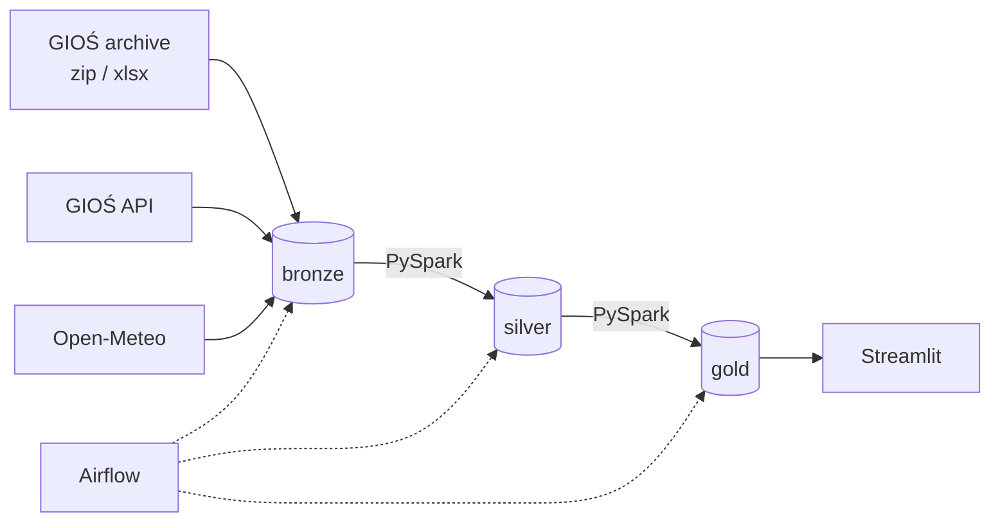

# poland-air-quality-lakehouse

Project that loads air quality data from GIOŚ (yearly archive since 2000 + live API) and weather data from Open-Meteo, processes it with PySpark and stores it as Delta tables. Everything runs locally in Docker.

## Architecture



Stack: PySpark 4.0 (standalone cluster), Delta Lake 4.0, SeaweedFS as S3 storage, Airflow 3.3, Streamlit, GitHub Actions.

## Layers

Bronze has raw data: original zips from the archive, xlsx sheets converted to csv (+ json with header info), API responses and weather responses.

Silver has cleaned data:
- `measurements` - all pollutants, hourly and daily values, partitioned by year and pollutant
- `stations`, `sensors`, `station_code_map` - station metadata and mapping of old station codes
- `station_history` - SCD2 history of stations from daily API snapshots
- `weather_hourly`

Gold:
- `dim_station`
- `daily_station` - daily means, a day counts only if it has at least 18 of 24 hours
- `annual_compliance` - annual means and exceedance days compared to EU limits and WHO 2021 guidelines
- `monthly_city`
- `daily_pm_weather` - daily PM10/PM2.5 joined with weather
- `dq_results` - results of data quality checks

## Problems with the data

The archive files are not consistent between years, so most of the cleaning is about that:

- the number of header rows is different (3 before 2016, 6 later) and in 2016-2018 the row with sensor codes has a different label
- in 2016-2018 numbers are saved as text with a comma (`"2,04478"`)
- timestamps have a few milliseconds of error from Excel, so they are rounded to full hours
- archive time is always UTC+1 (no summer time) and hourly values are marked with the end of the hour, the API uses local time with summer time, so both are converted to UTC start of the period
- old files use old station codes, and one old code can belong to two different stations, so the mapping checks which station was active in that year
- CO is in mg/m3 in the archive and in µg/m3 in the API
- manual sensors return HTTP 400 in the live API (their data is published later), so they are skipped
- Open-Meteo free plan has an hourly limit, so weather download can be resumed

Negative and unrealistic values are kept in silver with a `qa_flag` and are not used in aggregations. Data from the API is merged into silver but does not overwrite archive data.

## How to run

Docker with about 8 GB RAM is needed.

```bash
cp .env.example .env
docker compose up -d --build
```

- Airflow: http://localhost:8080
- Spark master: http://localhost:8081
- Dashboard: http://localhost:8501

In Airflow run `gios_archive_backfill` with e.g. `{"years": [2018, 2023, 2024]}` (around 3-4 min per year). `weather_backfill` takes the same parameter but it is slow because of the API limit (about one year per hour). `air_quality_daily` is the daily incremental run. All DAGs are paused by default.

Tests:

```bash
pip install -e ".[spark,dev]"
pytest              # spark tests are skipped without Java
make test-docker    # runs tests inside the spark container
```

## Results

PM10, stations with at least 75% of data in a year:

| | 2005 | 2018 | 2023 |
|---|---|---|---|
| stations | 169 | 222 | 251 |
| not meeting EU limits | 98 | 161 | 4 |
| mean of annual means [µg/m³] | 32.8 | 32.3 | 20.7 |

Daily PM10 and PM2.5 in 2023 depending on season and wind (low wind = below 10 km/h):

| heating season | low wind | PM10 | PM2.5 | days |
|---|---|---|---|---|
| no | no | 17.2 | 10.0 | 21209 |
| no | yes | 19.7 | 12.1 | 18311 |
| yes | no | 19.3 | 14.6 | 42020 |
| yes | yes | 33.0 | 26.0 | 12633 |

Correlation of daily PM10 with weather (2023): boundary layer height -0.44, wind speed -0.33, temperature -0.24.

Conclusions:
- PM10 went down a lot between 2018 and 2023, almost all stations meet EU limits now
- WHO guidelines are much stricter, in 2023 only about 7% of stations met the PM10 annual guideline
- the worst days are in the heating season when there is no wind, then PM10 is almost two times higher
- boundary layer height has the strongest relation with PM10, when it is low the pollution stays near the ground

## Project structure

```
conf/pipeline.yaml      config (sources, pollutants, archive file ids)
src/aq_lakehouse/
  ingestion/            downloading data to bronze
  spark/transforms/     transformations (tested)
  spark/jobs/           spark-submit jobs
  spark/scd2.py         SCD2 merge
  spark/quality.py      data quality checks
dags/                   Airflow DAGs
dashboard/              Streamlit app
docker/                 Dockerfiles
tests/
```

## TODO

- heavy metals and PAH data (different file format)
- Trino for SQL access
- streaming for live data instead of daily API calls
